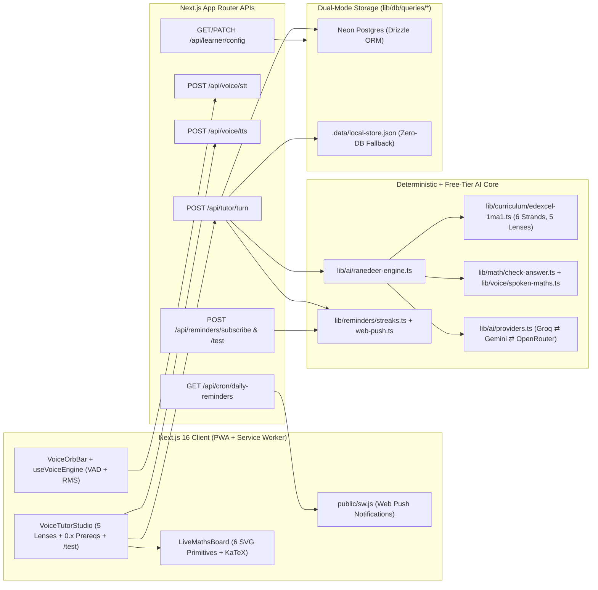

# Architecture — Mr. Ranedeer Voice Maths Tutor (Edexcel GCSE `1MA1`)

## 1. System Overview

## 2. Core Design Decisions

1. **Free-Tier First & Zero-Key Resilient**
   - Starting a lesson, switching between any of the **5 Explanation Lenses** (`visual`, `story`, `pattern`, `exam`, `socratic`), stepping back through **`0.1 → 0.x` Prerequisites**, and grading **`3/10 → 6/10 → 9/10` Mastery Tests** are 100% deterministic (`0 ms`, `0` LLM tokens).
   - Open-ended voice Q&A routes through `generateStructuredWithFallback` (`lib/ai/providers.ts`), cycling across Groq (`qwen/qwen3-32b`, `llama-3.3-70b-versatile`), Google AI Studio (`gemini-3.1-flash-lite`, `gemini-2.5-flash`), and OpenRouter (`:free`). `<think>...</think>` blocks from reasoning models are stripped prior to Zod `whiteboardStateSchema` validation.

2. **Voice-First Spoken-Maths Pipeline**
   - Student speech is captured via `MediaRecorder` + Web Audio RMS silence detection (`1.25s` auto-pause) and transcribed by Groq `whisper-large-v3-turbo` (or browser `SpeechRecognition` `en-GB` fallback).
   - `lib/voice/voice-commands.ts` intercepts natural Mr. Ranedeer spoken commands (*"explain it another way"*, *"show me visually"*, *"show me the exam method"*, *"test me"*, *"go back to basics"*).
   - `lib/voice/spoken-maths.ts` + `lib/math/check-answer.ts` evaluate spoken numbers, fractions (`"nineteen over twenty"` = `19/20` = `0.95`), money rounding near-misses, and spoken ambiguities (`"negative three squared"`).
   - `sanitizeForSpeech` ensures TTS (`edge-tts-universal` `en-GB-SoniaNeural` or `speechSynthesis` fallback) speaks natural British English rather than raw LaTeX.

3. **5-Table Schema with Zero-DB Local Fallback**
   - Defined in `lib/db/schema.ts` (`Learner`, `TopicProgress`, `TutorSession`, `PushSubscriptionRecord`, `DailyPracticeLog`) and accessed exclusively through `lib/db/queries/*`.
   - When `POSTGRES_URL` is configured, Drizzle queries Neon Postgres; when omitted in local dev or CI, `lib/db/local-store.ts` persists seamlessly to `.data/local-store.json`.
